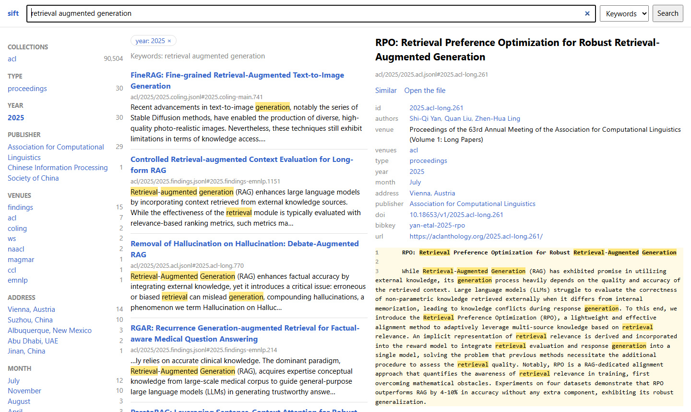

# sift: local RAG for AI agents

[](https://github.com/tobiaswuerth/sift/actions/workflows/ci.yml)
[](https://pypi.org/project/sift-rag/)
[](https://pypi.org/project/sift-rag/)
[](https://pypistats.org/packages/sift-rag)
[](https://github.com/tobiaswuerth/sift/actions/workflows/ci.yml)
[](https://github.com/tobiaswuerth/sift/blob/main/LICENSE)

**Local search over your documents, for AI agents.** sift indexes folders of documents and notes, embeds them on your
GPU, and serves keyword, semantic and hybrid search to Claude Code, Cursor and other agents as an MCP (Model Context
Protocol) server. Everything runs on your own machines: no cloud services, no API keys.



- **Three kinds of search, and more like one:** keywords (BM25), meaning (vectors), hybrid with cross-encoder
  reranking for RAG, and documents like a given one.
- **Your files as they are:** Markdown with front matter, Obsidian vaults, text, PDF (scans too, by OCR), Word,
  PowerPoint, Excel, OpenDocument, RTF, EPUB, HTML, emails and JSON Lines, indexed incrementally. sift never writes to
  them.
- **Built for agents:** front-matter filters, results citing their source lines, compact results, several queries per
  call; a note an agent just wrote is found by its next search.
- **Linked notes:** the links and backlinks of `[[wikilinks]]`, notes not written yet, and unlinked mentions.
- **A browser UI** to search, browse and read what sift holds yourself.
- **Runs on what you have:** NVIDIA or Apple GPUs, the CPU, or another machine's GPU, on Linux, macOS and Windows.

sift retrieves; it doesn't generate answers, watch files (an agent calls `reindex` after writing), OCR images other
than the pages of PDFs, or answer other machines: its server listens on 127.0.0.1 alone.

## Install

Python 3.12 or newer, built with SQLite 3.38 or newer, as uv's, python.org's and Homebrew's are. With
[uv](https://docs.astral.sh/uv/):

```bash
uv tool install --torch-backend auto sift-rag   # installs the `sift` command
```

With pip, in a virtual environment: `pip install sift-rag`. sift comes built for Linux on x86-64 and ARM (glibc 2.28
or newer), macOS on Apple silicon and Windows on x86-64; anywhere else the install builds its compiled part from the
sources, which needs Rust 1.100 or newer and a C compiler. The first use downloads two models from Hugging Face
(about 2 GB), each at the commit this version of sift pins: what their owners push later changes no vectors. The first
scan read on a GPU downloads a third, for OCR.

sift uses an NVIDIA GPU (CUDA) if there is one, else an Apple GPU, else the CPU, where `query` takes 15 to 25 seconds a
question instead of half of one. PyTorch from PyPI uses the GPU on Linux and macOS. On Windows, `--torch-backend auto`
installs the CUDA build for your driver; with pip, install PyTorch's CUDA build as
[pytorch.org](https://pytorch.org/get-started/locally/) shows for your system. If an NVIDIA GPU sits unused, sift says
so and prints the fix, `uv tool install --reinstall --torch-backend auto sift-rag`. A machine without a GPU can
[use another machine's](https://github.com/tobiaswuerth/sift/blob/main/docs/worker.md).

## Quick start

```bash
sift add ~/handbook --name handbook    # add a folder as a collection
sift index                             # read its files into the collection's store
sift embed                             # embed every passage that has no vector yet
sift query "who approves travel expenses abroad"
sift serve                             # MCP on http://127.0.0.1:8765/mcp, and the UI under /ui
```

`sift index` and `sift embed` process only what changed since their last run; an interrupted `sift embed` continues
where it stopped. While `sift serve` runs, it answers your `sift` commands too, with the models loaded once; without
it, each command works on its own. Or let your agent do it all: tell it to read and follow
[Setting sift up with an agent](https://github.com/tobiaswuerth/sift/blob/main/docs/agent-setup.md).

## Connect an agent

Leave `sift serve` running and register it with Claude Code once, for all projects:

```bash
claude mcp add --scope user --transport http sift http://127.0.0.1:8765/mcp
```

New sessions then show sift in `claude mcp list`. Without `--scope user` sift is registered for the current folder
only (undo there with `claude mcp remove sift --scope local`). Other MCP clients, such as Cursor, VS Code or
Windsurf, connect to the same streamable HTTP endpoint; one server serves any number of agents with the models loaded
once. For an agent that starts sift itself, over stdio: `claude mcp add --scope user sift -- sift serve --stdio`,
which starts `sift serve` if none runs (on Windows in a minimized window), and that one leaves after 15 idle minutes.
Connectors in claude.ai and the Claude apps' Chat tab can't use sift: they connect from Anthropic's servers, which
can't reach your computer.

| Tool | Purpose |
|---|---|
| `search` | Hybrid search for RAG (keyword and semantic candidates, reranked by a cross-encoder), or keyword search ranked by BM25 (`"phrases"`, `prefix*`, `AND`, `OR`, `NOT`, parentheses), or semantic search |
| `get` | Documents by id, whole or some of their lines, with front-matter `fields` |
| `related` | Documents alike in meaning to one, a note's links and backlinks, or the documents naming it without a link |
| `collections` | The collections: folders, counts, front-matter fields, links, and the jobs that run |
| `reindex` | Read files again right after they were written or deleted; changes only sift's stores, never a file |

Every hit carries `id` (`collection/path`), `title`, `first_line` and `last_line`, `score` and the passage's `text`;
the answer says what its scores are by (`scored_by`). One answer holds 100,000 characters of text: `get` cuts a longer
text at a line and says how to get the rest, and a search leaves the text of its last hits out and says so.
`search` takes up to 20 queries per call, filters on front matter, paths and links, `compact` (no text), `adaptive`
(only the results before the largest drop in score), `offset` to page on, and more; the tools' schemas describe every
parameter. When an agent connects, the server tells it which mode fits which kind of question, how to research in
rounds (several phrasings at once, a compact survey, then the best few read), and which collections and front-matter
fields exist.

## Commands

| Command | Does |
|---|---|
| `sift add FOLDER [--name NAME]` | Add a folder as a collection (`--store PATH` puts its store elsewhere, `--follow-links` reads files linked from outside it, `--title-from name` titles notes by file name) |
| `sift index [NAME ...] [--file PATH]` | Read new and changed files, of every active collection or those named; `--file`, repeated: only these |
| `sift embed [NAME ...] [--reset]` | Embed every passage without a vector; `--reset`: all of them again |
| `sift search`, `vsearch`, `query` `TEXT` | Keyword, semantic and hybrid search |
| `sift similar ID` | Documents near one in meaning |
| `sift get ID [ID ...] [--lines 14-23] [--fields a,b]` | Documents, or some of their lines |
| `sift links`, `unresolved`, `mentions` | Linked notes |
| `sift status [NAME ...] [--unreadable]` | Each collection's folder and what its store holds, as a table |
| `sift activate`, `deactivate NAME ...` | Take collections into searches again, or leave them out |
| `sift move [NAME ...] FOLDER` | Move the stores of collections, or of all, to another folder or drive |
| `sift rm NAME` | Remove a collection and its store; its files stay |
| `sift serve [--port N] [--stdio] [--idle-exit S]` | The home process: MCP, the UI under `/ui`, and your commands, on 127.0.0.1 (port 8765) |
| `sift ui [--no-browser]` | Search, browse and read in your browser |
| `sift jobs [--stop JOB]` | What `sift serve` does in the background, such as an agent's reindex |
| `sift worker [--port N] [--host H]` | Embed and rerank on this machine's GPU for other machines (port 8766) |
| `sift import [--home FOLDER] [-c NAME]` | Bring in the collections of an older home, their vectors kept ([Updating](#updating)) |
| `sift bench QUESTIONS.json` | How well each search mode finds the documents you expect |

Every command takes `--json` for an answer in JSON and `--color` for when to colour; `sift COMMAND --help` says the
rest. Search options, keyword syntax, filters, the formats sift reads, `.siftignore` and where sift keeps its files:
[usage](https://github.com/tobiaswuerth/sift/blob/main/docs/usage.md).

```bash
sift search '"notice period" AND (contract OR agreement)'
sift query "per diem abroad" -f departments=finance -f "created>=2024-06"
```

## Configuration

None needed: sift picks the device, its GPU memory budget and batch sizes itself. Optional environment variables:

| Variable | Default | Purpose |
|---|---|---|
| `SIFT_HOME` | `~/.sift` | The catalog, logs, the worker's key, and the stores unless moved |
| `SIFT_EMBED_MODEL` | `google/embeddinggemma-2` | Any Sentence Transformers embedding model, at a whole commit (`owner/model@<40 hex digits>`), or a folder; run `sift embed --reset` after a change |
| `SIFT_RERANK_MODEL` | `Alibaba-NLP/gte-reranker-modernbert-base` | Any Sentence Transformers cross-encoder, named the same way |
| `SIFT_EMBED_REMOTE` | none | A `sift worker` to embed and rerank on: the `https://<key>@<machine>:8766` address it prints |
| `SIFT_OCR` | `auto` | Where scans are read: `auto` on a GPU, `on` also on the CPU (slow), `off` never |
| `SIFT_UPDATE_CHECK` | `off` | `on`: once a day, a command run in a terminal asks PyPI whether a newer sift is out, and says so |
| `CUDA_VISIBLE_DEVICES` | every GPU | The NVIDIA GPUs sift may use; `-1` for none: the CPU |
| `HF_HUB_OFFLINE` | unset | `1`: models load from the cache alone, and sift never asks PyPI |
| `NO_COLOR` | unset | Set: no colours |
| `TERM` | | `dumb`: no colours, and progress written line by line |

The defaults are named at the commit sift pins them to. For business documents,
`Snowflake/snowflake-arctic-embed-l-v2.0` ties the default embedding model on average: better on financial questions
and long German documents, worse on scientific claims, and faster
([benchmarks](https://github.com/tobiaswuerth/sift/blob/main/docs/benchmarks.md#embedding-models)).

## Performance

Over 45.7 million passages in seven collections (PubMed, OpenAlex, arXiv and bioRxiv abstracts, ACL papers, Swiss
federal law and notes), each question asked for the first time, through `sift serve` with its models loaded, on a
desktop workstation whose CPU and GPU another job shared (median of 8 questions each):

| Use case | Mode | Time |
|---|---|---|
| A name, an id, a term | `search` | 0.16 s |
| A question, by its keywords | `search` | 0.6 s |
| By meaning | `vsearch` | 0.8 s |
| A question for RAG, reranked on the GPU | `query` | 1.1 s |
| Documents like one | `similar` | 0.6 s |

Asked again, with what they read in memory, each takes about half. The first semantic search of `sift serve` loads
the models and the vectors' codes, which it then keeps: for those 45.7 million passages, 104 seconds from a cold
disk. `sift embed` embeds 1,180 abstracts a second on that GPU, after compiling the model for 20 seconds; `sift index`
puts 3.3 million passages of arXiv in their topical order in two minutes. Every figure and how it was measured:
[benchmarks](https://github.com/tobiaswuerth/sift/blob/main/docs/benchmarks.md).

## Updating

```bash
uv tool upgrade sift-rag     # with pip: pip install -U sift-rag
```

Stop `sift serve` and `sift worker` first (on Windows a running sift holds the files an update replaces), then start
them again, and new agent sessions, which read sift's tools as they start. sift never updates itself; with
`SIFT_UPDATE_CHECK=on` it tells you when a newer version is out.

sift follows [semantic versioning](https://semver.org/): within a major version, the commands and their JSON output,
the MCP tools, the settings, the stores and the worker protocol stay compatible (sift's Python modules may change in any
release). When a release changes the stores' layout, its first command updates them once, without reading files or
embedding again. An older sift still opens such a store where the change allows it, and otherwise refuses it and
says to upgrade, so upgrade every sift sharing a home. The
[changelog](https://github.com/tobiaswuerth/sift/blob/main/CHANGELOG.md) says what each update takes.

**From sift 1.x**, whose stores sift 2 does not open: stop sift 1.x, then run `sift import` once in its home (or
`sift import --home FOLDER -c NAME` for another home or one collection). It adds each collection with its choices,
reads its folder anew and keeps the vector of every passage whose text is unchanged, so nothing is embedded twice. Each
new store goes beside the old one as `NAME-v2.sqlite`, and nothing of sift 1.x is written: once the collections are as
you want them, delete its stores and its `sift.db`. A store older than sift 1.15 is opened once with sift 1.15 first.
Agents need a new session; scripts need the ids of JSON Lines records and attachments, now `FILE#KEY`, and the
`--json` keys the changelog lists.

## Documentation

- [Usage](https://github.com/tobiaswuerth/sift/blob/main/docs/usage.md): collections, search options and syntax,
  filters, the formats sift reads, linked notes, the server, the UI, `sift bench`, where sift keeps its files
- [Setting sift up with an agent](https://github.com/tobiaswuerth/sift/blob/main/docs/agent-setup.md): the steps for an
  agent that installs sift and connects it for you
- [Another machine's GPU](https://github.com/tobiaswuerth/sift/blob/main/docs/worker.md): `sift worker`
- [How sift works](https://github.com/tobiaswuerth/sift/blob/main/docs/architecture.md): storage, the keyword and the
  vector index, and how each search ranks
- [Benchmarks](https://github.com/tobiaswuerth/sift/blob/main/docs/benchmarks.md): reference timings and the
  measurements behind the defaults
- [Limits](https://github.com/tobiaswuerth/sift/blob/main/docs/limits.md): every bound sift sets, from the longest
  query to how long it waits
- [Contributing](https://github.com/tobiaswuerth/sift/blob/main/docs/CONTRIBUTING.md),
  [security](https://github.com/tobiaswuerth/sift/blob/main/docs/SECURITY.md),
  [changelog](https://github.com/tobiaswuerth/sift/blob/main/CHANGELOG.md),
  [license (MIT)](https://github.com/tobiaswuerth/sift/blob/main/LICENSE)
