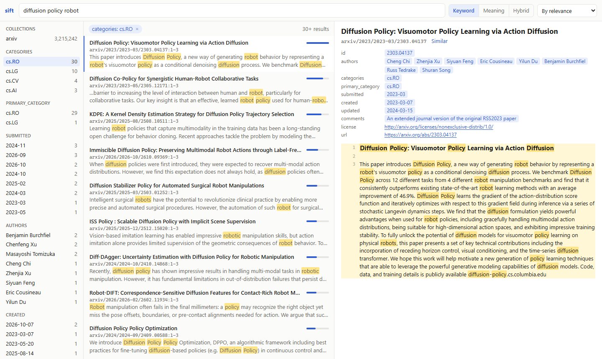

# sift

[](https://github.com/tobiaswuerth/sift/actions/workflows/ci.yml)
[](https://pypi.org/project/sift-rag/)
[](https://pypi.org/project/sift-rag/)
[](https://pypistats.org/packages/sift-rag)
[](https://github.com/tobiaswuerth/sift/actions/workflows/ci.yml)
[](https://github.com/tobiaswuerth/sift/blob/main/LICENSE)

**Local search over your documents, for AI agents.** sift indexes folders of documents and notes, embeds them on your
GPU, and serves keyword, semantic and hybrid search to Claude Code and other agents over MCP (Model Context Protocol).
Everything runs on your own machines: no cloud services, no API keys.



## Features

- **Four kinds of search:** exact keywords (BM25), meaning (vectors), hybrid with cross-encoder reranking for RAG, and
  documents like a given one.
- **Your files as they are:** Markdown with front matter, text, PDF (scans too, by OCR), Word, PowerPoint, Excel,
  OpenDocument, RTF, EPUB, HTML, saved emails and JSON Lines, indexed incrementally. sift never writes to them.
- **Built for agents:** filters on front-matter fields, results that cite their source lines, and compact results that
  save context. A note an agent just wrote is found by the next search.
- **Linked notes:** in an Obsidian vault or any Markdown with `[[wikilinks]]`, the links and backlinks of a note, the
  notes not written yet, and the documents that mention a note without linking it.
- **A browser UI** to search, browse and read the index yourself.
- **Measured, not guessed:** the default models and ranking were chosen on seven retrieval benchmarks
  ([benchmarks](https://github.com/tobiaswuerth/sift/blob/main/docs/benchmarks.md)).
- **Runs on what you have:** NVIDIA or Apple GPUs, the CPU, or another machine's GPU, on Linux, macOS and Windows.
  Tens of millions of passages fit on one machine.

## Install

Requires Python 3.11 or newer. With [uv](https://docs.astral.sh/uv/):

```bash
uv tool install --torch-backend auto sift-rag   # installs the `sift` command
```

Or run it without installing: `uvx --torch-backend auto sift-rag serve`. With pip, in a virtual environment:
`pip install sift-rag`. On first use, sift downloads its two models from Hugging Face (about 2 GB).

**GPU.** sift uses an NVIDIA GPU (CUDA) if there is one, else an Apple GPU, else the CPU, which embeds slowly and
reranks in about 25 seconds per query on 8 threads (0.3 seconds on an RTX 4090). On Linux and macOS, PyTorch from PyPI
already uses the GPU. On Windows it doesn't: uv's `--torch-backend auto` picks the CUDA build that matches your
driver, and with pip run `pip install --force-reinstall --no-deps torch torchvision --index-url
https://download.pytorch.org/whl/cu128` afterwards. If an NVIDIA GPU sits unused, sift says so on start-up and prints
the command that fixes it. A machine without a GPU can [borrow one](#another-machines-gpu).

## Quick start

```bash
sift add ~/handbook --name handbook    # register a folder as a collection
sift index                             # read its files and build the keyword index
sift embed                             # embed every passage that has no vector yet
sift query "who approves travel expenses abroad"
sift serve                             # MCP server on http://127.0.0.1:8765/mcp, and the UI under /ui
```

`sift index` and `sift embed` are incremental: run them again after files change, and only what changed is processed.
An interrupted `sift embed` goes on where it stopped.

## Connecting agents

1. Start the server and leave it running: `sift serve`.
2. Register it with Claude Code, once, for all your projects:

   ```bash
   claude mcp add --scope user --transport http sift http://127.0.0.1:8765/mcp
   ```

   Keep `--scope user`: without it, sift is registered for the current folder only, and sessions started anywhere
   else don't see it, including those in the Claude desktop app's Code tab. Such a registration is removed, in the
   folder where it was made, with `claude mcp remove sift --scope local`.
3. Start a new Claude Code session. `claude mcp list` shows sift as connected, and an agent asked for sift's status
   lists your collections.

One server serves any number of agents, with the models loaded once. Other MCP clients, such as Cursor, VS Code or
Windsurf, connect the same way, to the streamable HTTP endpoint `http://127.0.0.1:8765/mcp`. To have every session
start a server of its own instead, over stdio: `claude mcp add --scope user sift -- sift serve --stdio`. Connectors
in claude.ai and in the Chat tab of the Claude apps can't use sift: claude.ai reaches connectors from Anthropic's
servers, which can't reach your computer.

| Tool | Purpose |
|---|---|
| `search` | Exact keyword search, ranked by BM25: `"phrases"`, `prefix*`, `AND`, `OR`, `NOT`, parentheses |
| `vsearch` | Semantic search |
| `query` | Hybrid search for RAG: keyword and semantic candidates, reranked by a cross-encoder |
| `similar` | Documents like a given one |
| `get` | A document's text by its id, all of it or only some `lines`, with front-matter `fields` if asked |
| `status` | The collections: folders, counts, front-matter fields, links |
| `links` | A note's links, each with where it leads, and the notes linking to it |
| `unresolved` | Link targets no note answers to yet |
| `mentions` | Documents that name a note without linking to it |
| `reindex` | Read files again right after writing, changing or deleting them; the one tool that changes anything: sift's index, never a file |

The search tools take `k`, `collection`, `path`, `filters`, `fields`, `compact`, `all_passages`, `sort`, `links_to`
and `linked_from`. Every result carries `id` (`collection/path`), `title`, `lines`, `score` and the passage's `text`,
so agents can cite their sources; `compact: true` leaves out the text, so an agent can survey many results and read
the ones that matter. Every parameter is described in the tools' schemas, and the server tells agents on connecting
which collections there are and which front-matter fields each has.

## Commands

| Command | Does |
|---|---|
| `sift add FOLDER --name NAME` | Register a folder as a collection (`--store PATH` puts its index elsewhere) |
| `sift index [--files PATH ...]` | Read new and changed files; with `--files`, only those, at once |
| `sift embed [NAME ...]` | Embed every passage without a vector, of every active collection or those named |
| `sift search`, `vsearch`, `query` `TEXT` | Keyword, semantic and hybrid search |
| `sift similar ID` | Documents like this one |
| `sift get ID [--lines 14-23] [--fields a,b]` | A document, or some of its lines |
| `sift links`, `unresolved`, `mentions` | Linked notes |
| `sift status` | Collections: folders, active or not, index files, sizes and counts, as JSON |
| `sift activate`, `deactivate NAME ...` | Take collections into searches, or leave them out |
| `sift move [NAME ...] TO` | Move collections' indexes to another folder or drive |
| `sift rm NAME` | Remove a collection and its index; its files stay on disk |
| `sift ui` | Search, browse and read the index in your browser |
| `sift serve [--stdio]` | The MCP server, and the UI under `/ui` |
| `sift worker` | Embed and rerank for other machines on this one's GPU |
| `sift bench QUESTIONS.json` | How well each search mode finds the answers you expect |

Search commands take `-k`, `-c COLLECTION`, `--path GLOB`, `-f FIELD=VALUE` filters, `--fields`, `--compact`,
`--all-passages`, `--sort=-FIELD`, `--links-to`, `--linked-from` and `--json`:

```bash
sift search '"notice period" AND (contract OR agreement)'
sift query "per diem abroad" -f departments=finance -f "created>=2024-06"
sift links vault/People/Hans.md --direction both
```

Every command may run while `sift serve` does; the server finds what a command wrote with its next search.
[docs/usage.md](https://github.com/tobiaswuerth/sift/blob/main/docs/usage.md) covers search syntax and scores, filters
and front matter, every format sift reads, linked notes, `.siftignore`, the UI, `sift bench`, and where the indexes
lie.

## Configuration

None needed: sift picks the device, the GPU memory budget and the batch size itself. Five optional environment
variables exist for special cases:

| Variable | Default | Purpose |
|---|---|---|
| `SIFT_HOME` | `~/.sift` | The catalog, the logs and the worker's key, and the collections' indexes unless moved |
| `SIFT_EMBED_MODEL` | `google/embeddinggemma-2` | Any Sentence Transformers embedding model |
| `SIFT_RERANK_MODEL` | `Alibaba-NLP/gte-reranker-modernbert-base` | Any Sentence Transformers cross-encoder |
| `SIFT_EMBED_REMOTE` | none | A `sift worker` to embed on: the `https://<key>@workstation:8766` it prints |
| `SIFT_OCR` | `auto` | Where scans are read: `auto` on a GPU, `on` also on the CPU (slow), `off` never |

After changing the embedding model, run `sift embed --reset`. For business documents,
`Snowflake/snowflake-arctic-embed-l-v2.0` ties the default on average: better on financial questions and long German
documents, worse on scientific claims, and 1.6 times as fast
([benchmarks](https://github.com/tobiaswuerth/sift/blob/main/docs/benchmarks.md)).

## Another machine's GPU

A machine without a GPU can embed and rerank on another one's. Run `sift worker` there; it prints a line such as
`SIFT_EMBED_REMOTE=https://<key>@workstation:8766` to set on the machine without. The texts travel over HTTPS, the
worker's certificate is pinned by the key, and the worker sees no index and no files. Setup, firewall and security:
[docs/worker.md](https://github.com/tobiaswuerth/sift/blob/main/docs/worker.md).

## Updating

```bash
uv tool upgrade sift-rag     # with pip: pip install -U sift-rag
```

Then restart `sift serve` and `sift worker`, and start new agent sessions: an MCP client reads sift's tools when a
session starts, and a running session misses new ones. Machines that embed through a worker need the same major
version as the worker.

The index and the vectors carry over. When a release changes how the index is laid out, its first command updates it,
once, and says so, from what the index holds: no file is read again and nothing is embedded again. From 1.7 or older,
the index is split into a file per collection: stop every other sift first, and have as much free space as the index
takes; `sift move FOLDER` as the first command splits it straight into that folder, on another drive too. 1.9 counts
each collection's rows once: about 10 seconds for 14 million vectors, longer from a cold disk. An older sift doesn't
open an index so updated, so upgrade every sift that uses it. The
[changelog](https://github.com/tobiaswuerth/sift/blob/main/CHANGELOG.md) lists every change.

## How it works

Each collection's index is a SQLite file: documents, FTS5 keyword index, fp16 vectors and their one-bit codes.
Semantic search compares a query's code with every passage's, kept in RAM (96 bytes each), and scores the 4,000
nearest exactly; it finds 99.6% of exact search's top 10 over 3.2 million abstracts in about 0.1 seconds, with no
index to build. `query` reranks the best 40 keyword and semantic candidates on the GPU. Embedding runs in batches of
similar length, sized to the GPU memory left by other programs, and gives the GPU back after 5 idle minutes. Details:
[docs/architecture.md](https://github.com/tobiaswuerth/sift/blob/main/docs/architecture.md).

## Scope

In scope: text, Markdown and JSON Lines files, PDF (scans too), office documents, e-books, web pages and saved emails;
Linux, macOS and Windows; NVIDIA GPUs (CUDA) and Apple GPUs (MPS), otherwise the CPU; one user, any number of local
agents.

Out of scope for now: OCR of pictures that aren't PDFs; answer generation (sift retrieves, the agent writes);
approximate nearest-neighbour indexes; live file watching (an agent calls `reindex` after writing); remote access and
authentication; writing to your files.

## Versioning

sift follows [semantic versioning](https://semver.org/). Within a major version, such as 1.x, these stay compatible:
the commands, their options and their JSON output; the MCP tools and their parameters; the settings; the index, which
every later 1.x opens and updates on first use if it must; and the worker protocol, so every 1.x embeds through every
1.x worker. sift's Python modules are its own and may change in any release.

## Development

```bash
git clone https://github.com/tobiaswuerth/sift
cd sift
uv venv && uv pip install --torch-backend auto -e ".[dev]"   # or with pip: pip install -r requirements.txt -e ".[dev]"
pre-commit install      # lint, format and config checks on every commit
pytest --cov            # 100% line and branch coverage is required
```

The tests replace the models with small deterministic fakes, so they need no GPU and no downloads; everything else,
the MCP server included, runs for real. See
[CONTRIBUTING.md](https://github.com/tobiaswuerth/sift/blob/main/CONTRIBUTING.md) for how changes and releases work.

## License

[MIT](https://github.com/tobiaswuerth/sift/blob/main/LICENSE)
