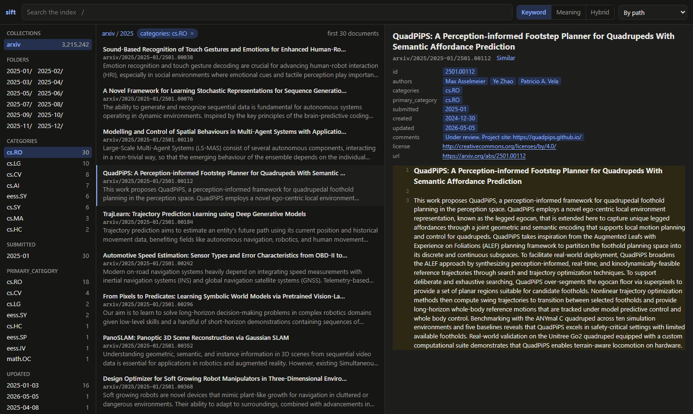

# Using sift

The details behind the [README](https://github.com/tobiaswuerth/sift#readme): collections and where their indexes lie,
searching and filtering, the formats sift reads, linked notes, the browser UI and measuring search quality.

- [Collections](#collections)
- [Searching](#searching)
- [Front matter and filters](#front-matter-and-filters)
- [What sift reads](#what-sift-reads)
- [Linked notes](#linked-notes)
- [The browser UI](#the-browser-ui)
- [Measuring search on your own documents](#measuring-search-on-your-own-documents)

## Collections

A collection is a folder sift indexes. `sift add FOLDER` registers one, named after the folder unless `--name NAME` says
otherwise; `sift index` reads its files and `sift embed` embeds their passages. Both are incremental: run them again
after files change, and only new or changed files are processed. Deleted files are removed; the files of a folder that
can't be read for the moment (access denied, a share that doesn't answer) are kept as indexed, as are those of a
collection whose folder is missing. An interrupted `sift embed` continues where it stopped, and a running server picks
up new vectors on its own.

A folder inside a collection, or one that holds a collection, isn't added: the files of both would be indexed twice,
once in each collection. `sift add --nested` adds it anyway.

### Where the indexes lie

Each collection's index is a SQLite file of its own, `collections/NAME.sqlite` under `SIFT_HOME` (`~/.sift`), where
the catalog `sift.db` lists them, beside the logs and the worker's key. A large index can go anywhere else:

```bash
sift add ~/archive --store D:/sift                  # a new collection's index in another folder
sift add ~/archive --store D:/data_archive.sqlite   # or under a name of your choice
sift move D:/sift                                   # every collection's index into another folder
sift move archive D:/data_archive.sqlite            # one collection's, under a name of your choice
```

On the same drive a move is instant; to another drive the index is copied, then the old file deleted. No other sift
may have the index open meanwhile: stop `sift serve`, and any `sift index` or `sift embed` of that collection, first.
Beside an index lies an empty `NAME.sqlite.postings-lock`, which a sift locks while it updates the keyword postings,
so that two never do at once; `sift move` and `sift rm` take it with the index.
A collection whose index is missing, on a drive that isn't connected, is passed over by searches and said so on the
server's console; `sift status` marks it `"missing": true`. sift never makes such an index anew. So is one whose index
can't be opened, damaged or updated by a newer sift; `sift status` gives the reason as `"error"`.

### Active and inactive collections

`sift deactivate NAME ...` leaves collections out: searches pass them over, a running server lets go of their
vectors' codes with its next request, a server started afterwards doesn't name them to agents, and `sift index` and
`sift embed` skip them unless named. Their indexes stay as they are, `reindex` still updates them, and `sift activate
NAME ...` takes them back. `sift status` lists every collection, `"active"` or not, with its index file (`"store"`),
its size in bytes and, if active, its counts of documents, chunks and vectors, and how its keyword postings stand
(`"keywords"`): `"ready"`, `"not built"`, or how many chunks they are behind. Until they are ready, keyword searches of
the collection read FTS5, slower on a large one; `sift index` builds or updates them.

### Leaving files out

sift indexes the files it has a reader for, but not those in folders whose name starts with a dot, such as
`.obsidian/` or `.git/`, nor in `node_modules` and `__pycache__`, nor in linked folders (symbolic links, and junctions
on Windows); a linked file is read as the file it points to, wherever that lies. A `.siftignore` file in a
collection's folder leaves out more, in gitignore's syntax:

```gitignore
# drafts, exports and what an app keeps for itself
drafts/
/exports
*.tmp.md
**/private/**
!private/README.md
```

- `*`, `?` and `[abc]` match within a name and `**` across folders.
- A pattern with a slash at its start or in its middle is taken from the collection's folder; one without matches at
  any level. A slash at the end matches folders only.
- `!` takes back in what an earlier pattern left out, but never a file in a folder left out.
- Folders are separated by `/`, on Windows too, since `\` escapes the character after it, as in `\#notes.md`.
- Case counts as on the file system: on Windows and macOS, not at all, nor how a letter such as `ü` is encoded.

Only the `.siftignore` in the collection's folder counts; if sift can't read it, `sift index` skips the collection and
says so. The next `sift index` follows a changed `.siftignore`: what it leaves out now leaves the index, and what it
no longer leaves out joins it; `reindex` refuses what it leaves out.

### Logs, and commands beside a running server

The commands that change the index or serve it (`add`, `rm`, `index`, `embed`, `serve`, `worker`) each write what they
say, with the time of each line, to a log of their own, such as `logs/serve-2026-10-23_210509.log` under
`SIFT_HOME`: the server's requests and the errors of the libraries it runs too, a long step's progress once a minute,
and how the command ended if it failed. Every log is kept.

Every command but `sift move` may run while `sift serve` does: they share the collections' indexes, each of which takes
one write at a time (the next waits up to 30 seconds), and the server finds what a command wrote with its next search.
Of the vectors' codes, it reads only those `sift embed` added; after other changes to a collection's vectors it reads
all of them again in the background, while searches go on with those it holds.

## Searching

| Command | Finds | Score |
|---|---|---|
| `search` | Exact keyword matches, ranked by BM25 | 0 and up |
| `vsearch` | Passages close in meaning to the query | cosine, -1 to 1 |
| `query` | Keyword and semantic candidates, reranked by a cross-encoder: the best for RAG | the reranker's, nudged by the cosine |
| `similar` | Documents like a given one, by its id | cosine, -1 to 1 |

Scores rank the results of one search, each kind on a scale of its own. `query`'s scores also compare across queries:
with the default reranker, close matches score about 2.5 to 4, and unrelated results below 2. How fast and how
well each finds, on one workstation and per kind of question:
[reference values](https://github.com/tobiaswuerth/sift/blob/main/docs/benchmarks.md#reference-values).

### Options

Search commands return one result per document, with its best passage, and one per work: a paper that several
collections hold under the same DOI (front-matter field `doi`) is the best ranked copy, which lists the others under
`also`. They accept:

| Option | Effect |
|---|---|
| `-k N` | Number of results, at most 10,000 |
| `-c NAME` | Only this collection |
| `--path GLOB` | Only paths within the collection that match, e.g. `"2024/*"` |
| `-f FIELD=VALUE` | Front-matter filter, repeatable (see [below](#front-matter-and-filters)) |
| `--fields a,b` | Front-matter fields to show with each hit, e.g. `url,created`, or `*` for all |
| `--compact` | Results without their text |
| `--all-passages` | Every matching passage, several per document |
| `--sort=-created` | Order by a front-matter field instead of score; `-` for descending |
| `--links-to`, `--linked-from` | Only documents linking to a note, or linked from it (see [Linked notes](#linked-notes)) |
| `--adaptive` | Up to `k` results: those before the largest drop in score, and five more |
| `--budget SECONDS` | `search` only: stop after about this long, once anything is found, with the best found so far, each marked `partial` |
| `--json` | JSON output |

### Keyword syntax

`search` requires every term. If no passage has them all and the query has no operators (`AND`, `OR`, `NOT`,
`NEAR`), it returns the passages that have any of them, ranked by BM25, which favours those with more of them and
with rarer ones. Operators are written in capitals, and parentheses group: `'"notice period" AND (contract OR
agreement)'`. `"phrases"` and `prefix*` work as in SQLite FTS5. A query with operators is taken as it is; when it
finds nothing, drop terms. Input that isn't valid FTS5 syntax is searched as exact phrases.

Keyword search covers the front matter too, so an author's name or an id finds its documents, in `search` and in
`query`. `meta:` limits a term to the front matter and `title:` to the title, e.g. `sift search "meta: Smith"`.

### Reading a document

```bash
sift get handbook/hr/leave.md                           # the whole document
sift get handbook/hr/leave.md --lines 14-23             # only some lines, e.g. those of a search hit
sift get handbook/hr/leave.md --fields owner,modified   # front-matter fields first, then the text
```

An id is `collection/path`. It may leave out folders if the file name is unique, or be the file's absolute path.

## Front matter and filters

YAML front matter with flat `key: value` lines becomes filterable metadata; lists can be inline, quoted or not
(`aliases: [Hans Mueller, H. Müller]`), or one `- item` per line:

```markdown
---
title: "Travel expenses"
departments: ["finance", "hr"]
year: 2025
tags:
  - travel
  - expenses
---
```

A value is read as JSON first, so a program that writes front matter can write each value as JSON on its line and
rely on it: a JSON string reads back as exactly that string, whatever it holds (quotes, colons, `#`, brackets, `---`,
`\n`), and numbers, `true`, `false`, `null`, lists and objects read as such. Anything that isn't JSON is read as
described above.

```bash
sift query "per diem abroad" -f departments=finance -f year=2025
sift search policy -f departments=finance -f departments=legal   # in either department
sift search policy -f departments!=legal                         # not in legal
sift search invoice -f "created>=2024-06" -f "created<2025"      # a range
```

- Filters on different fields must all hold. Repeated for one field, `=` matches any of the values, and `!=` leaves
  out documents with any of them; documents without the field stay in.
- A list field matches when it contains the value.
- Ranges take `>`, `>=`, `<` and `<=`. Dates compare at the precision given, so `created<=2024` includes all of 2024
  and `created>2024` starts in 2025; a number compares with the number a date starts with.
- Fields go by the names the front matter gives them, e.g. `-f journal-ref=Nature` or `-f "date created>=2024"`.
- Over MCP, `filters` maps each field to a value, a list for any of its values, `{"not": ...}`, or ranges, e.g.
  `{"created": {">=": "2024-06", "<": "2025"}}`.

The `title` field, or else the first heading outside code blocks, or else the file name, becomes the document's title;
in a collection added with `--title-from name`, the file name comes before the heading (see
[Linked notes](#linked-notes)). A note of front matter alone, such as a contact's, has its front matter as its passage.

## What sift reads

| Format | Read as |
|---|---|
| Markdown, text | Chunks of about 3,000 characters on line boundaries, preferring headings; a Markdown file's YAML front matter as metadata |
| JSON Lines (`.jsonl`, `.ndjson`) | One document per line, its fields found by name (below) |
| PDF, Word, PowerPoint, Excel, OpenDocument, RTF, EPUB, HTML | Markdown, by [Xberg](https://github.com/xberg-io/xberg) |
| Scanned PDFs | Markdown, by OCR on the GPU (below) |
| Saved emails (`.eml`) | The message, and each attachment as a document of its own (below) |

Damaged files are skipped and reported, until they change. Older binary Office files (`.doc`, `.ppt`, `.xls`) aren't
read. Text files are read as UTF-8, or as UTF-16 when they start with its byte order mark.

### JSON Lines

A `.jsonl` (or `.ndjson`) file holds one document per line, as a JSON object. sift finds the fields by name:

| Part | Field |
|---|---|
| id | `id` or `_id`, else the line number |
| title | `title`, `name`, `headline` or `subject` |
| text | the first of `text`, `content`, `body`, `abstract`, `description` and `summary`, else the longest string; a list of strings becomes paragraphs |
| metadata | every other field, for filters and `fields`, as front matter is for Markdown |

A record's id is its file's path plus its id: line `{"id": "T-1042", ...}` of `2025/tickets.jsonl` in the collection
`support` becomes `support/2025/tickets/T-1042`, which `get` also finds as `support/T-1042`. Other field names can be
chosen when adding the collection:

```bash
sift add ~/qa --id key --title question --text question,answer
```

Lines that aren't JSON objects, have no text or repeat an id are skipped and reported.

### Documents and scans

Office documents, PDFs, e-books and web pages are converted to Markdown: headings stay headings, slides become
sections and sheets become tables, and `get` returns that Markdown. The document's properties become metadata as far
as the file has them: `title`, `authors`, `subject`, `keywords`, `language`, `created` and `modified`. The title is the
document's own, else the first heading, else the file name.

**Scans**, PDFs without text of their own as scanners and phones make them, are read with OCR: their pages, as
pictures at 200 dpi, by [LightOnOCR-2](https://huggingface.co/lightonai/LightOnOCR-2-1B), a model of one billion
parameters (Apache-2.0), which writes each page as Markdown, tables and columns in reading order.

- It runs on the GPU the other models use, in about 3 GB, once per scan: an RTX 4090 reads a page in 15 to 30
  seconds, a dense one in up to a minute. The first scan downloads the model (2 GB).
- Up to 50 pages of a scan are read, and its metadata says `ocr`. A mail's attached scan is read like any other.
- On a machine without a GPU, scans are skipped and reported, unless `SIFT_OCR=on` has the CPU read them, at minutes
  a page; `SIFT_OCR=off` never reads them. A scan skipped while other programs hold the GPU's memory, or one OCR
  failed on, is read again by the next `sift index`.
- The server's `reindex` leaves scans to the next `sift index`, as reading one would hold up every search meanwhile;
  `sift index --files` reads them at once.

### Emails

A saved email (`.eml`) is a document titled by its subject, with `From`, `To`, `Cc` and `Date` above its text, which
is its plain text, else its HTML as Markdown. Its metadata holds the addresses bare, for filters, and the date as
ISO 8601 in UTC, for ranges and sorting: `from`, `to`, `cc`, `date`, `message_id`, `in_reply_to` and `attachments`,
the file names.

An attachment sift reads is a document of its own, named by its file name: `mail/2026/offer.eml` holds
`mail/2026/offer/contract.pdf`. So is a mail attached to a mail, as mail clients forward one "as attachment", named
by its subject if it has no file name, with its attachments below it, three levels deep: `mail/2026/fwd.eml` holds
`mail/2026/fwd/Offer.eml` and `mail/2026/fwd/Offer/price.pdf`.

```bash
sift search "price list" -f from=anna@acme.example -f "date>=2026-06"
```

## Linked notes

In an Obsidian vault, or any folder of Markdown notes that link to each other, sift keeps the links of every note as
written and resolves them when asked, as Obsidian does. Obsidian names a note by its file name, so add a vault with
its notes titled so; `sift add` suggests it for a folder with `.obsidian/` in it:

```bash
sift add ~/vault --title-from name     # for a vault added before, the same command retitles its notes
```

**Links** are `[[Note]]`, `[[Folder/Note]]`, `[[Note|shown text]]`, `[[Note#Heading]]`, `[[Note#^block]]`, embeds
such as `![[contract.pdf]]`, and Markdown links such as `[text](../People/Hans.md)`, in the text and, as wikilinks, in
front-matter values: `org: "[[Acme AG]]"`. Links in code, to web addresses, and to files sift doesn't read, such as
images, are left out.

**A link resolves** within its note's collection:

1. a relative path, `[text](../People/Hans.md)` or `[[./Hans]]`, to the file at that path from the note's folder;
2. a path, `[[01_People/Hans Müller]]`, to the file whose path it is, else the one file whose path ends with it;
3. a name, `[[Hans Müller]]`, to the one file of that name, or of several, the one in the note's folder;
4. and else to the one note whose `aliases` hold it, which Obsidian itself doesn't do.

Names compare in any case, and a note's name leaves out `.md`. A link that several files match is ambiguous, and one
that none matches is unresolved: a note not written yet. As links resolve when asked, they follow notes as they come
and go, without the linking notes being read again.

```bash
sift links vault/People/Hans.md                  # each link of the note, and where it leads
sift links "Hans Müller" --direction in          # the notes linking to it, with the lines that do
sift links "Acme AG" --direction in --field org --depth 2   # through org only, and one step further
sift unresolved -c vault                         # the notes the vault lacks, most linked first
sift mentions "Hans Müller" --also emails        # documents naming the note without a link
sift search contract --links-to "Acme AG"        # only documents linking to Acme AG
sift search contract --linked-from "Hans Müller" # only documents Hans Müller links to
sift search contract -f "org=[[Acme AG]]"        # org links to Acme AG, however written: [[acme ag|Acme]] too
```

A note is named by its id or as links name it, if one note answers to that name. `mentions` looks for a note's file
name, title and aliases as phrases, and for a name with ä, ö, ü or ß also as written with ae, oe, ue or ss; names
shorter than three characters are left out. `links` and `unresolved` return at most 50 (`-k`); `mentions` takes `-k`,
`-c`, `--fields` and `--compact` as searches do.

**A note written a moment ago** is found by the next search, if the agent that wrote it calls `reindex` (or you run
`sift index --files`): it reads those files at once, or drops the documents of files that are gone, without scanning
the collection. Over MCP it also embeds their new passages, if the index is embedded, and a running server takes up
their codes without loading the others again. sift still never writes to your files.

## The browser UI

`sift ui` opens the index in your browser, at `http://127.0.0.1:8765/ui/`, to look through the sources yourself. It
uses the `sift serve` that runs on that port, or starts one, which then serves agents too.



- **Search** in three modes: *Keyword* as you type, *Meaning* and *Hybrid* (`vsearch` and `query`) on Enter. The
  words found are marked in each passage, and a bar shows each result's score.
- **Drill down** without typing: collections and their folders, and the front-matter values of the results with their
  counts (authors, categories, years), each a click to filter by. Filters show as chips; click one to remove it.
  Results can also be sorted by any front-matter field.
- **Read** a result next to the list: the whole document, its passage marked and scrolled to, and its front matter,
  whose values filter too, and whose links open. A long document shows 2,000 lines at a time. *Similar* lists
  documents like it, *Backlinks* and *Links* the notes linking to it and those it links to, and *Open file* opens the
  original file: a PDF shows in the browser's viewer, and other files open without running any script they hold.
- **Keys:** `/` to search, `↑` `↓` to move through results, `Enter` to open one.
- Every view has its own address, so reloading, the back button and links work.

## Measuring search on your own documents

`sift bench` runs each search mode over questions whose answers you know and reports nDCG@10, MRR@10 and Recall@10,
the measures of the BEIR and TREC benchmarks, and the time per query. Write the questions as an agent would ask them,
with the ids of the documents that answer them, as search results show them:

```json
[
  {"query": "Which supplier terms changed in 2025?", "relevant": ["work/contracts/supplier-2025.docx"]},
  {"query": "onboarding checklist for new hires", "relevant": {"work/hr/onboarding.pdf": 2, "work/hr/it-setup.md": 1}}
]
```

```bash
sift bench questions.json            # -c NAME: one collection only
```

A few dozen questions are enough to compare modes and to see whether a change helps your documents. Grades are
optional: 2 for the answer, 1 for a useful one, and 0, as in TREC's judgements, for one read and found irrelevant.
A document counts as found when a hit is it or lists it under `also`, as a copy of the same paper; copies of one paper
found as one hit count as one, with the best grade of them.
