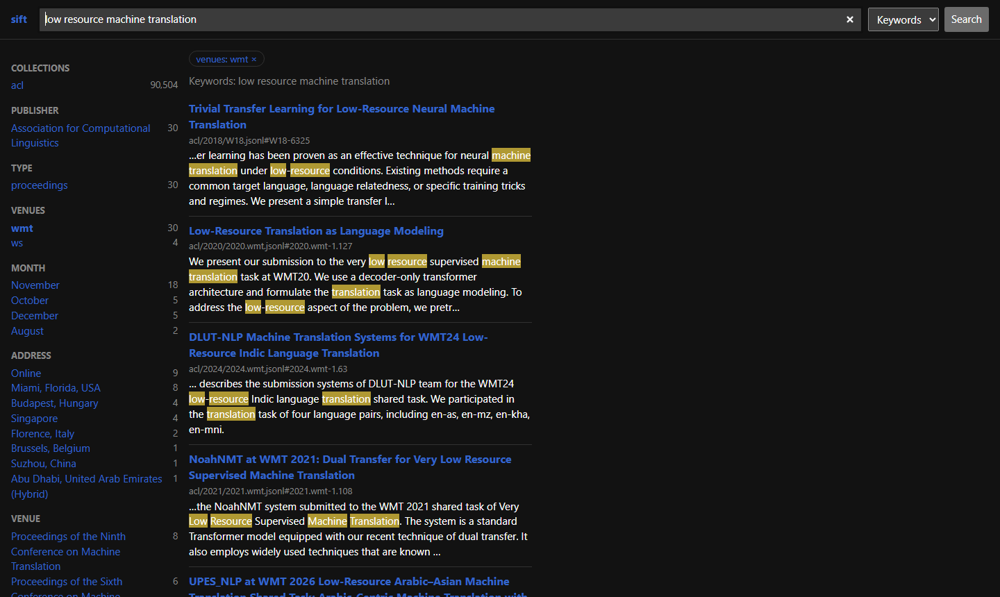

# Using sift

The details behind the [README](https://github.com/tobiaswuerth/sift#readme).

- [Collections](#collections): adding, indexing, leaving files out, where indexes and logs lie
- [Searching](#searching): modes and scores, options, keyword syntax, reading documents
- [Front matter and filters](#front-matter-and-filters)
- [What sift reads](#what-sift-reads): formats, JSON Lines, documents and scans, emails
- [Linked notes](#linked-notes)
- [The browser UI](#the-browser-ui)
- [Measuring search on your own documents](#measuring-search-on-your-own-documents)

## Collections

A collection is a folder sift indexes: `sift add FOLDER [--name NAME]` registers it, `sift index` reads its files and
`sift embed` embeds their passages. Both are incremental: they process only new and changed files, remove deleted
ones, and an interrupted `sift embed` continues where it stopped. Files of a folder that can't be read for the moment
(access denied, a share that doesn't answer), or of a collection whose folder is missing, stay indexed as they were.

A folder inside a collection, or holding one, isn't added, as its files would be indexed twice; `--nested` adds it
anyway.

**Active and inactive.** `sift deactivate NAME ...` leaves collections out of searches, of a newly started server's
list for agents, and of `sift index` and `sift embed` unless named; a running server drops their vectors' codes with
its next request. Their indexes stay, `reindex` still updates them, and `sift activate NAME ...` takes them back.

**Status.** `sift status` lists every collection as JSON: `"active"`, its index file (`"store"`) and size, and for
active ones the counts of documents, chunks and vectors, and the keyword postings (`"keywords"`): `"ready"`, `"not
built"`, or how many chunks behind. Until they are ready, keyword searches read SQLite's FTS5 index, slower on large
collections; `sift index` builds them. A collection whose index is missing (a drive not connected) is passed over by
searches and marked `"missing": true`; sift never makes such an index anew. One that can't be opened (damaged, or
updated by a newer sift) is passed over too, with the reason as `"error"`.

### Leaving files out

sift reads the files it has a reader for, except in folders whose name starts with a dot (`.obsidian/`, `.git/`), in
`node_modules` and `__pycache__`, and in linked folders (symbolic links, junctions); a linked file is read as the file
it points to. A `.siftignore` in the collection's folder leaves out more, in gitignore's syntax:

```gitignore
drafts/
/exports
*.tmp.md
**/private/**
!private/README.md
```

- `*`, `?` and `[abc]` match within a name, `**` across folders. A pattern with a slash at its start or middle is
  taken from the collection's folder; one without matches at any level; a trailing slash matches folders only.
- `!` takes back what an earlier pattern left out, but never a file in a folder left out.
- Folders are separated by `/`, on Windows too; `\` escapes the next character (`\#notes.md`).
- Case counts as on the file system: on Windows and macOS not at all.

Only the `.siftignore` in the collection's folder counts. If it can't be read, `sift index` skips the collection and
says so. The next `sift index` follows a changed `.siftignore` both ways; `reindex` refuses files it leaves out.

### Where indexes and logs lie

Everything sift keeps lies under `SIFT_HOME` (`~/.sift`):

| Path | What | Lifecycle |
|---|---|---|
| `sift.db` | The catalog: collections, folders, where their indexes lie | Made on first use |
| `collections/NAME.sqlite` | A collection's index, a SQLite file | Made by `sift add`, deleted by `sift rm`, moved by `sift move` |
| `collections/NAME.sqlite.postings-lock` | Empty; locked while a sift updates the keyword postings | Moved and deleted with its index |
| `logs/COMMAND-DATE.log` | What `add`, `rm`, `index`, `embed`, `serve` and `worker` said, timed, with errors | Kept; delete freely |
| `logs/update-DATE.log` | What an update you agreed to did | Kept; delete freely |
| `update.json` | The latest version on PyPI, when it was asked, and an update waiting or done | Rewritten daily, through `update.json.PID.part` for a moment; delete freely |
| `worker/` | `sift worker`'s certificate and token, readable by you only | Delete it to make a new key |
| `numba/` | The compiled search code `sift serve` and `sift bench` keep | Made again when deleted |

An index can lie anywhere else:

```bash
sift add ~/archive --store D:/sift                  # a new collection's index in another folder
sift add ~/archive --store D:/data_archive.sqlite   # or under a name of your choice
sift move D:/sift                                   # every collection's index into another folder
sift move archive D:/data_archive.sqlite            # one collection's
```

A move on the same drive is instant; to another drive the index is copied, then deleted. Stop `sift serve`, and any
`sift index` or `sift embed` of that collection, first.

Every command but `sift move` may run while `sift serve` does: each index takes one write at a time (the next waits up
to 30 seconds), and the server finds what a command wrote with its next search.

## Searching

| Mode | Finds | Score |
|---|---|---|
| `search` | Exact keyword matches, ranked by BM25 | 0 and up |
| `vsearch` | Passages close in meaning | cosine, -1 to 1 |
| `query` | Keyword and semantic candidates reranked by a cross-encoder: the best for RAG | the reranker's, nudged by the cosine |
| `similar` | Documents like a given one, by its id | cosine, -1 to 1 |

Scores rank the results of one search. `query`'s also compare across queries: with the default reranker, close matches
score about 2.5 to 4, unrelated results below 2. Each result is a document with its best passage; a paper that several
collections hold under one DOI (front-matter `doi`) is one result, the best ranked copy, listing the others under
`also`.

### Options

The commands' options; the MCP tools take the same as parameters (`k`, `collection`, `path`, `filters`, ...).

| Option | Effect |
|---|---|
| `-k N` | Number of results, at most 10,000 |
| `-c NAME` | Only this collection |
| `--path GLOB` | Only paths within the collection that match, e.g. `"2024/*"` |
| `-f FIELD=VALUE` | Front-matter filter, repeatable ([below](#front-matter-and-filters)) |
| `--fields a,b` | Front-matter fields to show with each hit, or `*` for all |
| `--compact` | Results without their text |
| `--all-passages` | Every matching passage, several per document |
| `--sort=-created` | Order the `k` results by a front-matter field instead of score; `-` for descending. It orders the best `k`, not every match: for the newest of all, filter on a range too (`-f created>=2026`) |
| `--links-to`, `--linked-from` | Only documents linking to a note, or linked from it ([Linked notes](#linked-notes)) |
| `--adaptive` | Only the results before the largest drop in score, and five more, up to `k` |
| `--budget SECONDS` | `search` only: stop after about this long, once anything is found, with the hits marked `partial` |
| `--json` | JSON output |

Over MCP, `search`, `vsearch` and `query` take up to 20 queries in one call, returning a list of results for each; the
queries share `search`'s budget.

### Keyword syntax

`search` requires every term; when no passage has them all and the query has no operators, it returns passages with any
of them, ranked by BM25. Operators are capitals, parentheses group, and `"phrases"` and `prefix*` work as in SQLite
FTS5: `'"notice period" AND (contract OR agreement)'`. A query with operators is taken as written; when it finds
nothing, drop terms. Input that isn't valid FTS5 syntax is searched as exact phrases.

The front matter is searched too, so an author's name or an id finds its documents. `meta:` limits a term to the front
matter and `title:` to the title: `sift search "meta: Smith"`.

### Reading a document

```bash
sift get handbook/hr/leave.md                           # the whole document
sift get handbook/hr/leave.md --lines 14-23             # only some lines, e.g. a hit's
sift get handbook/hr/leave.md --fields owner,modified   # front-matter fields, then the text
sift get handbook/hr/leave.md handbook/hr/travel.md     # several, each headed by its id
```

An id is `collection/path`; folders may be left out if the file name is unique, or it can be the file's absolute path.
Over MCP, `get` takes up to 100 documents, each an id or `{"id": ..., "lines": "14-23"}`; past 100,000 characters in
all, the rest are left out, each saying so.

## Front matter and filters

YAML front matter of flat `key: value` lines becomes filterable metadata. Lists can be inline
(`aliases: [Hans Mueller, H. Müller]`) or one `- item` per line. A value is read as JSON first, so a program can write
each value as JSON and get exactly it back; anything else is read as YAML-like text.

```markdown
---
title: "Travel expenses"
departments: ["finance", "hr"]
year: 2025
---
```

```bash
sift query "per diem abroad" -f departments=finance -f year=2025
sift search policy -f departments=finance -f departments=legal   # either department
sift search policy -f departments!=legal                         # not legal
sift search invoice -f "created>=2024-06" -f "created<2025"      # a range
```

- Filters on different fields must all hold. Repeated on one field, `=` matches any of the values and `!=` excludes
  all of them; documents without the field stay in.
- A list field matches when it contains the value.
- A value matches whether the document writes it as a number or as text: `-f year=2024` finds `year: 2024` and
  `"year": "2024"`, and `true` and `false` likewise.
- Ranges take `>`, `>=`, `<`, `<=`. Dates compare at the precision given: `created<=2024` includes all of 2024; a number
  compares with the number a date starts with, and passes over text that doesn't start with one (`year: unknown`).
- Field names are as written in the front matter: `-f journal-ref=Nature`, `-f "date created>=2024"`.
- Over MCP, `filters` maps each field to a value, a list (any of them), `{"not": ...}`, or ranges:
  `{"created": {">=": "2024-06", "<": "2025"}}`.

A document's title is its `title` field, else its first heading outside code, else its file name (with
`--title-from name`, the file name first). A note of front matter alone has its front matter as its passage.

## What sift reads

| Format | Read as |
|---|---|
| Markdown, text | Chunks of about 3,000 characters on line boundaries, preferring headings; YAML front matter as metadata |
| JSON Lines (`.jsonl`, `.ndjson`) | One document per line ([below](#json-lines)) |
| PDF, Word, PowerPoint, Excel, OpenDocument, RTF, EPUB, HTML | Markdown, by [Xberg](https://github.com/xberg-io/xberg) |
| Scanned PDFs | Markdown, by OCR ([below](#documents-and-scans)) |
| Saved emails (`.eml`) | The message, and each attachment as a document of its own ([below](#emails)) |

Text files are read as UTF-8, or UTF-16/UTF-32 after a byte order mark. Damaged files are skipped and reported until
they change. Old binary Office files (`.doc`, `.ppt`, `.xls`) aren't read.

A JSON Lines record or an email attachment is a document below its file's name: record `a.md` of `data.jsonl` is
`data/a.md`. Where a real file has that path too, the first indexed keeps it; the other is left out, said, and read
once the path is free.

### JSON Lines

Each line is a JSON object; sift finds its parts by field name:

| Part | Field |
|---|---|
| id | `id` or `_id`, else the line number |
| title | `title`, `name`, `headline` or `subject` |
| text | the first of `text`, `content`, `body`, `abstract`, `description`, `summary`, else the longest string; a list of strings becomes paragraphs |
| metadata | every other field, as front matter |

Line `{"id": "T-1042", ...}` of `2025/tickets.jsonl` in collection `support` is `support/2025/tickets/T-1042`, which
`get` also finds as `support/T-1042`. Records without an id are keyed by line number, so a line inserted above them
re-embeds every record after it. Other field names: `sift add ~/qa --id key --title question --text question,answer`.
Lines that aren't objects, have no text or repeat an id are skipped and reported.

### Documents and scans

Office documents, PDFs, e-books and web pages become Markdown: headings stay headings, slides become sections, sheets
tables, and `get` returns that Markdown. Their properties become metadata where present: `title`, `authors`,
`subject`, `keywords`, `language`, `created`, `modified`. A web page's title is its first heading, else its file name.

**Scans** (PDFs without text, as scanners and phones make them) are read by
[LightOnOCR-2](https://huggingface.co/lightonai/LightOnOCR-2-1B) (1B parameters, Apache-2.0), page by page as Markdown,
tables and columns in reading order; their metadata says `ocr`.

- On a desktop GPU, in about 3 GB: 15 to 30 seconds a page, up to a minute for a dense one; at most 50 pages a scan. The
  first scan downloads the model (2 GB).
- Without a GPU, scans are skipped and reported; `SIFT_OCR=on` reads them on the CPU (minutes a page), `off` never.
  A scan skipped because the GPU's memory was taken, or OCR ran out of it, is read again by the next `sift index`;
  so are those skipped before `SIFT_OCR` was turned on, or from `off` to `auto`.
- `reindex` leaves scans to the next `sift index`, so searches don't wait; `sift index --files` reads them at once.

### Emails

A `.eml` is a document titled by its subject, with `From`, `To`, `Cc` and `Date` above its plain text (else its HTML as
Markdown). Its metadata: `from`, `to`, `cc` (bare addresses), `date` (ISO 8601, in UTC where the mail gives its time zone), `message_id`, `in_reply_to`,
`attachments`.

Each attachment sift can read is a document below the mail: `mail/2026/offer.eml` holds `mail/2026/offer/contract.pdf`.
A forwarded mail is one too, named by its subject if it has no file name, with its attachments below it, three levels
deep.

```bash
sift search "price list" -f from=anna@acme.example -f "date>=2026-06"
```

## Linked notes

In an Obsidian vault, or any folder of Markdown notes that link to each other, sift keeps each note's links as written
and resolves them when asked, as Obsidian does. Obsidian names notes by file name, so add a vault with
`--title-from name` (suggested for a folder holding `.obsidian/`; for a vault added before, the same command retitles).

**Links** are `[[Note]]`, `[[Folder/Note]]`, `[[Note|text]]`, `[[Note#Heading]]`, `[[Note#^block]]`, embeds
(`![[contract.pdf]]`) and Markdown links (`[text](../People/Hans.md)`), in the text and, as wikilinks, in front-matter
values (`org: "[[Acme AG]]"`). Links in code, to web addresses and to files sift doesn't read are left out.

**A link resolves** within its note's collection, in this order: a relative path, from the note's folder; a path, to
the file with that path, else the one file whose path ends with it; a name, to the one file of that name, or of several
the one in the note's folder; else the one note whose `aliases` hold it. Names compare in any case, without `.md`. A
link several files match is ambiguous; one none matches is unresolved, a note not written yet. Resolved when asked,
links follow notes as they come and go.

```bash
sift links vault/People/Hans.md                  # the note's links, and where each leads
sift links "Hans Müller" --direction in          # the notes linking to it, with the lines
sift links "Acme AG" --direction in --field org --depth 2   # through org only, two steps
sift unresolved -c vault                         # notes the vault lacks, most linked first
sift mentions "Hans Müller" --also emails        # documents naming the note without a link
sift search contract --links-to "Acme AG"        # only documents linking to Acme AG
sift search contract -f "org=[[Acme AG]]"        # org links to Acme AG, however written
```

A note is named by its id, or as links name it if one note answers to that. `mentions` looks for a note's file name,
title and aliases as phrases (ä, ö, ü, ß also as ae, oe, ue, ss; names under three characters left out). `links` and
`unresolved` return at most 50 (`-k`).

**A note just written** is found by the next search once the agent calls `reindex` (or you run `sift index --files`):
it reads those files at once, or drops the documents of files gone, and over MCP embeds their new passages too.

## The browser UI

`sift ui` opens the index at `http://127.0.0.1:8765/ui/`, using the `sift serve` on that port or starting one.



- **Search** by *Keyword* as you type, *Meaning* or *Hybrid* on Enter; found words are marked, and a bar shows each
  score.
- **Drill down** through collections, folders and the results' front-matter values with their counts; each a click to
  filter by, shown as a chip to remove. Sort by any front-matter field.
- **Read** a result beside the list, its passage marked, with its front matter, *Similar*, *Backlinks*, *Links* and
  *Open file* (PDFs in the browser's viewer; other files open without running their scripts).
- **Keys:** `/` to search, `↑` `↓` to move, `Enter` to open. Every view has its own address.

## Measuring search on your own documents

`sift bench` runs each search mode over questions whose answers you know and reports nDCG@10, MRR@10, Recall@10 and the
time per query. Write the questions as an agent would ask them, with the ids of the documents that answer them:

```json
[
  {"query": "Which supplier terms changed in 2025?", "relevant": ["work/contracts/supplier-2025.docx"]},
  {"query": "onboarding checklist for new hires", "relevant": {"work/hr/onboarding.pdf": 2, "work/hr/it-setup.md": 1}}
]
```

```bash
sift bench questions.json            # -c NAME: one collection only
```

A few dozen questions are enough to compare modes, or to see whether a change helps your documents. Grades are
optional: 2 for the answer, 1 for a useful one, 0 for one read and found irrelevant. A copy of the same paper listed
under `also` counts as found.
